<div align="center">

# ⚡ Apague y vámonos

**Saber cuánto te cuesta, en pesos, cada dispositivo de tu casa, y pagar menos que tu promedio de EPM.**

App móvil para Android e iPhone · Enchufes inteligentes Tuya · Tarifa real de EPM · Medellín, Colombia

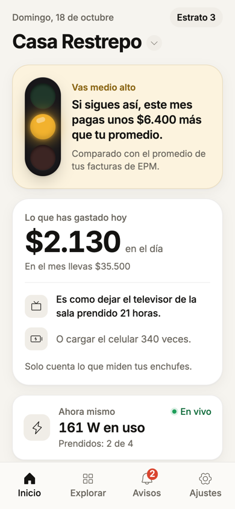&nbsp;
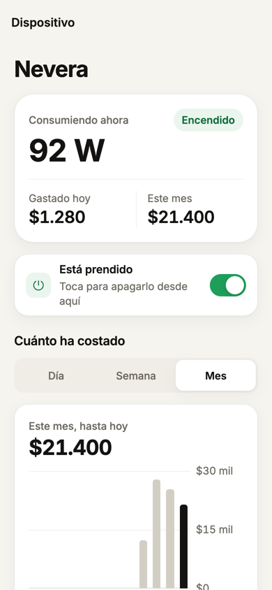&nbsp;
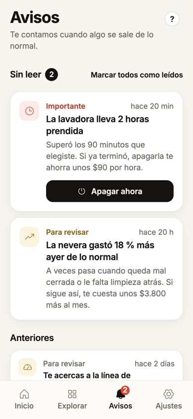&nbsp;
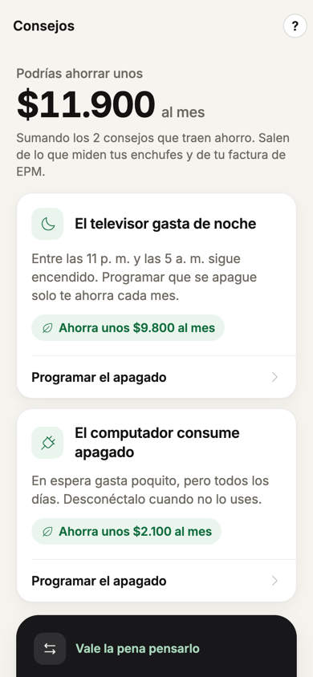

Proyecto de Ingeniería 1 · Universidad de Medellín · Reto 2: gestión del consumo energético doméstico

</div>

---

## Contenido

| | Sección | Para quién |
| :-: | --- | --- |
| 1 | [Qué es](#1-qué-es) | Todos |
| 2 | [Cómo funciona](#2-cómo-funciona) | Todos |
| 3 | [Guía de uso paso a paso](#3-guía-de-uso-paso-a-paso) | Quien usa la app |
| 4 | [Preguntas frecuentes](#4-preguntas-frecuentes) | Quien usa la app |
| 5 | [Instalar y correr el proyecto](#5-instalar-y-correr-el-proyecto) | Desarrolladores |
| 6 | [Cómo está hecho](#6-cómo-está-hecho) | Desarrolladores |
| 7 | [Pruebas y calidad](#7-pruebas-y-calidad) | Desarrolladores y evaluadores |
| 8 | [Seguridad y datos](#8-seguridad-y-datos) | Todos |
| 9 | [Estado y pendientes](#9-estado-y-pendientes) | El equipo |
| 10 | [Documentación](#10-documentación) | Todos |

> [!TIP]
> ¿No sabes nada de programación? Lee primero la **[guía completa del producto](docs/guia-del-producto.md)**: explica todo, de la idea al código, con analogías y un glosario.

---

## 1. Qué es

Una familia recibe la factura de EPM una vez al mes y solo ve un total. **No sabe qué dispositivo se lleva la plata** hasta que ya es tarde. «Apague y vámonos» lo cambia:

| Lo que ves | Ejemplo | Para qué sirve |
| --- | --- | --- |
| 💰 **Pesos, no kilovatios** | «La nevera lleva $1.280 hoy» | Entender el gasto sin saber de electricidad |
| 🚦 **Un semáforo** | «Vas medio alto: si sigues así, pagas $6.400 más que tu promedio» | Saber a mitad de mes si vas bien |
| 🔁 **Equivalencias** | «Es como dejar el televisor prendido 21 horas» | Hacer tangible el gasto |
| 🔔 **Avisos** | «La lavadora lleva 2 horas prendida» con el botón **Apagar ahora** | Actuar a tiempo |
| 🔌 **Control** | Prender y apagar desde el teléfono, y **rutinas** por horario | Apagar sin estar en casa |
| 💡 **Consejos** | «Podrías ahorrar unos $11.900 al mes» | Saber qué cambiar primero |
| 🧮 **Simulador** | «Sí te conviene cambiar la nevera: se paga sola en 5 años y 4 meses» | Decidir una compra con números |
| 🪫 **Prepago** | «Tu saldo te alcanza hasta el lunes 26» | No quedarte sin luz |

**La promesa del producto:** que la familia pague **menos que el promedio mensual de sus facturas de EPM**. Todo se mide contra eso.

---

## 2. Cómo funciona

Hay cuatro piezas, y **la app nunca habla directo con el fabricante del enchufe**: todo pasa por nuestro servidor.

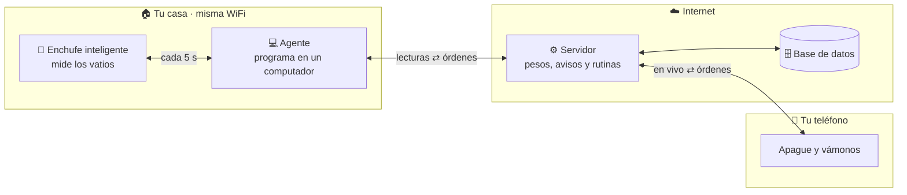

| Pieza | Qué hace | Analogía |
| --- | --- | --- |
| 🔌 **Enchufe** | Mide cuánta electricidad pasa al dispositivo y se puede prender o apagar | La cocina |
| 💻 **Agente** | Lee el enchufe cada 5 s por la WiFi; si se cae internet, guarda y reenvía después | El mesero |
| ⚙️ **Servidor** | Guarda todo, calcula pesos con la tarifa de EPM, revisa los avisos cada 20 s y ejecuta las rutinas | La administración |
| 📱 **App** | Muestra todo y manda tus órdenes | La vitrina |

### De la pared a tu pantalla en menos de medio segundo

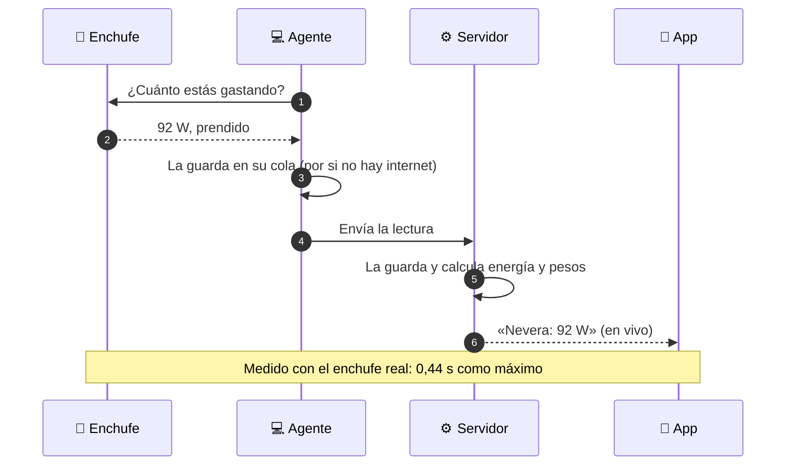

### Cuando tocas «Apagar ahora»

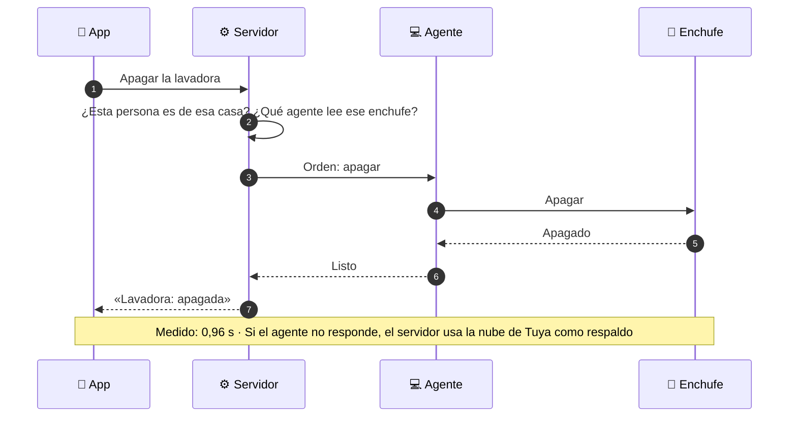

---

## 3. Guía de uso paso a paso

### Lo que necesitas

| ✅ | Qué | Detalle |
| :-: | --- | --- |
| ☐ | Un teléfono Android o iPhone | Con la app instalada (para la demo: Expo Go, ver [sección 5](#5-instalar-y-correr-el-proyecto)) |
| ☐ | Enchufes inteligentes Tuya | Probado con el **BSD04** (Vii Smart): máx. 10 A ≈ 1.100 W. ⚠️ No sirve para aire acondicionado, plancha ni calentadores |
| ☐ | La app **Smart Life** | La del fabricante: ahí se emparejan los enchufes con tu WiFi |
| ☐ | Un computador en la casa | Hoy un Mac, prendido y en la **misma WiFi de 2,4 GHz** que los enchufes |
| ☐ | Tu factura de EPM | Para copiar los kWh de los últimos 6 meses |

### El recorrido completo

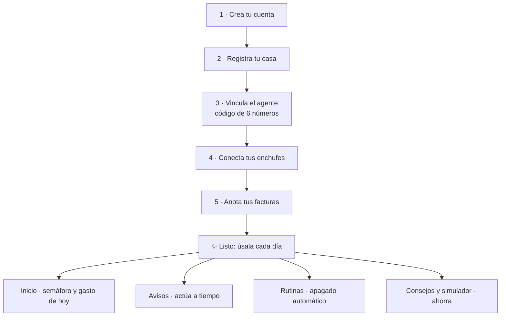

---

### Paso 1 · Crea tu cuenta

<table><tr>
<td width="210">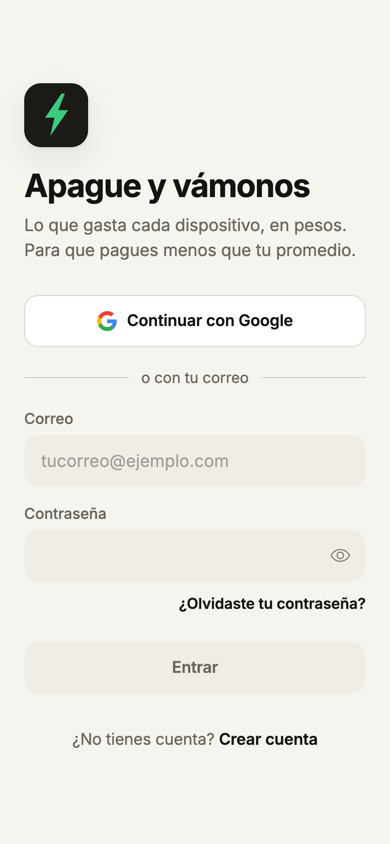</td>
<td>

1. Abre la app y toca **Continuar con Google**, o escribe tu correo y una contraseña de **8 caracteres o más** y toca **Crear cuenta**.
2. Lee y acepta el **tratamiento de datos** (lo exige la Ley 1581 de 2012).
3. Si entraste con correo, en **Ajustes** toca **Correo sin verificar** y confírmalo con el código que te llega.

💡 ¿Olvidaste la contraseña? En la entrada toca **¿Olvidaste tu contraseña?**: te llega un código de 6 números que vale 15 minutos.

</td>
</tr></table>

### Paso 2 · Registra tu casa

<table><tr>
<td width="210">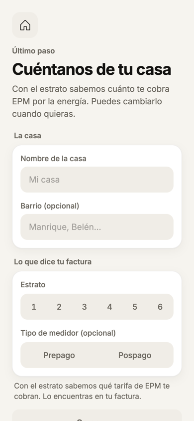</td>
<td>

1. Escribe un **nombre** («Casa Restrepo») y el **barrio**.
2. Elige el **estrato** (de él depende la tarifa) y el **tipo de medidor**: normal o **prepago**.
3. Toca **Guardar**.

💡 Puedes tener **varias casas** (por ejemplo, la de tu mamá): en **Inicio**, toca el nombre de la casa para cambiar de una a otra.

</td>
</tr></table>

### Paso 3 · Vincula el agente (el programa del computador)

<table><tr>
<td width="210">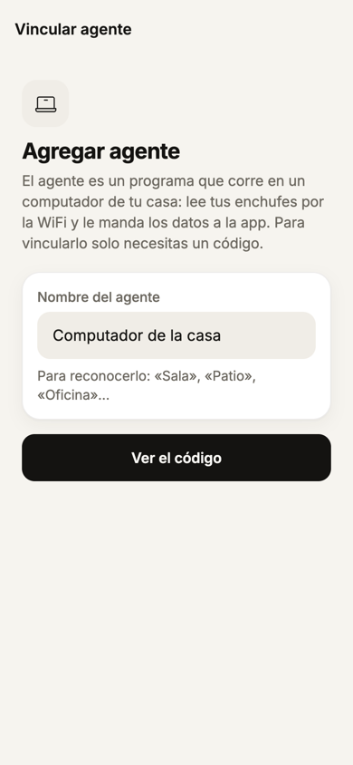</td>
<td>

1. En la app: **Explorar › Agentes › Agregar agente**. Ponle un nombre («Computador de la sala») y toca **Ver el código**.
2. Aparecen **6 números**, que valen 10 minutos.
3. En el computador, abre el programa **«Apague y vámonos»** y escribe esos 6 números.
4. La app dice **«¡Listo! … está conectado»**. En el Mac queda un ⚡ en la barra de menús.

💡 La primera vez, en el Mac: clic derecho sobre el programa → **Abrir**, porque aún no tiene firma de Apple de pago.

</td>
</tr></table>

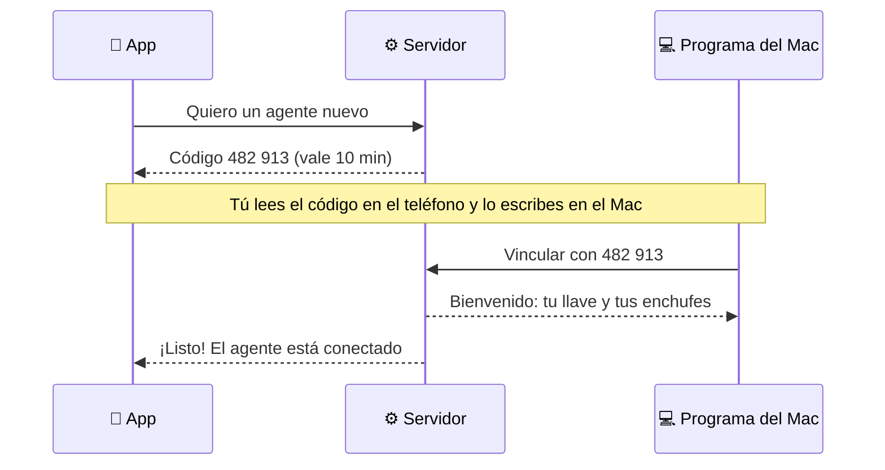

### Paso 4 · Conecta tus enchufes

<table><tr>
<td width="210">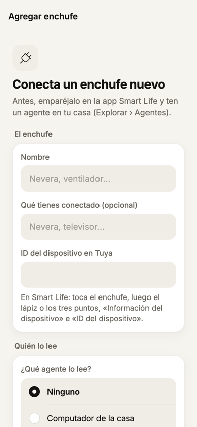</td>
<td>

1. Primero empareja el enchufe en **Smart Life** con tu WiFi de 2,4 GHz.
2. En Smart Life, busca su **ID**: toca el enchufe → lápiz o tres puntos → **Información del dispositivo** → **ID del dispositivo**.
3. En nuestra app: **Explorar › Enchufes › Conectar un enchufe**:
   - **Nombre:** «Nevera».
   - **Qué tienes conectado.**
   - **ID de Tuya:** el que copiaste.
   - **¿Qué agente lo lee?:** el que vinculaste.
4. Si es un dispositivo que no debe quedarse prendido (una plancha de pelo, por ejemplo), márcalo **de riesgo** y elige **los minutos encendido antes de avisar**.

💡 ¿Los vatios no cuadran con un medidor de referencia? Abre el enchufe y usa **Calibrar**.

</td>
</tr></table>

### Paso 5 · Anota tus facturas (para que el semáforo sepa qué es «lo normal»)

<table><tr>
<td width="210">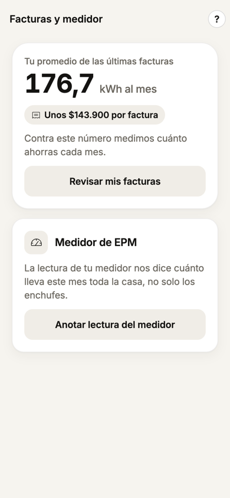</td>
<td>

1. **Explorar › Facturas y medidor › Mis facturas.**
2. Copia los **kWh de los últimos 6 meses** del cuadro de consumo histórico de tu factura de EPM.
3. Opcional, pero recomendado: anota de vez en cuando la **lectura del medidor**. Con dos lecturas en días distintos, la app proyecta cómo cierra el mes de **toda la casa**, no solo lo que miden los enchufes.

</td>
</tr></table>

---

### El día a día

#### 🏠 Inicio: cómo vas hoy

<table><tr>
<td width="210"></td>
<td>

- **El semáforo** compara cómo va a cerrar el mes con el promedio de tus facturas:

  | Luz | Significa |
  | :-: | --- |
  | 🟢 | Vas igual o por debajo de tu promedio |
  | 🟡 | Hasta 10 % por encima: vas medio alto |
  | 🔴 | Más de 10 % por encima |
  | ⚫ | Falta un dato (las facturas o el medidor): toca el botón para anotarlo |

- **Lo que has gastado hoy**, en pesos, con una **equivalencia**.
- **Ahora mismo:** los vatios en uso y cuántos dispositivos están prendidos.
- **Qué está gastando más:** cada dispositivo con su costo de hoy y su **interruptor** para prenderlo o apagarlo.

</td>
</tr></table>

#### 📊 Un dispositivo: cuánto ha costado

<table><tr>
<td width="210"></td>
<td>

Toca un dispositivo en Inicio para ver:

- **Consumiendo ahora** (vatios), **gastado hoy** y **este mes**.
- El **interruptor** para prenderlo o apagarlo.
- **Cuánto ha costado**, en tres vistas:

  | Vista | Muestra |
  | --- | --- |
  | **Día** | Las 24 horas de hoy |
  | **Semana** | Los últimos 7 días |
  | **Mes** | **Cada mes con lo que costó** (los últimos 12) y la lista del más reciente al más viejo |

</td>
</tr></table>

#### 🔔 Avisos: actúa a tiempo

<table><tr>
<td width="210"></td>
<td>

| Aviso | Cuándo llega |
| --- | --- |
| ⏱️ **Lleva mucho tiempo prendido** | Un dispositivo de riesgo pasa los minutos que elegiste. Trae **Apagar ahora** |
| 📈 **Gastó más de lo normal** | Ayer gastó más que en sus 7 días anteriores (10 %, 20 % o 50 %, según la sensibilidad) |
| 🧭 **Línea de subsistencia** | Vas en el 80 % y en el 100 % de los 130 kWh subsidiados del mes |
| 🪫 **Saldo prepago** | Te queda poco; en rojo si es menos de 48 horas |

Abajo eliges **¿Cada cuánto te avisamos?**: *Pocas*, *Normales* o *Muchas*. Los importantes llegan siempre.

</td>
</tr></table>

#### ⏰ Rutinas: que se apague solo

<table><tr>
<td width="210">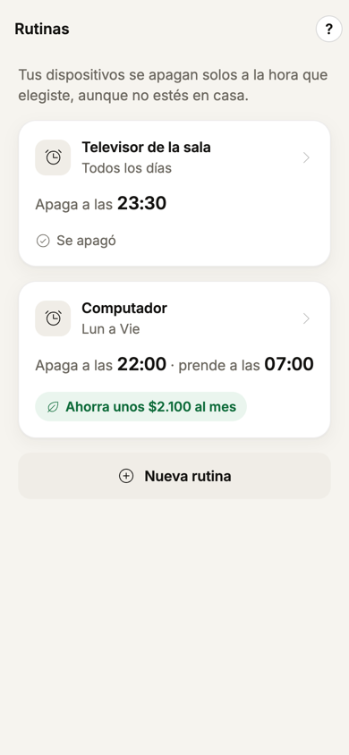</td>
<td>

1. **Explorar › Rutinas › Nueva rutina.**
2. Elige el dispositivo, **los días** y **la hora de apagado**. Si quieres, también una **hora de encendido**.
3. Listo: el servidor la cumple aunque tu teléfono esté apagado.

Ejemplo: «Televisor de la sala · todos los días · se apaga a las 23:30».

</td>
</tr></table>

#### 💡 Consejos y simulador: ahorra

<table><tr>
<td width="210">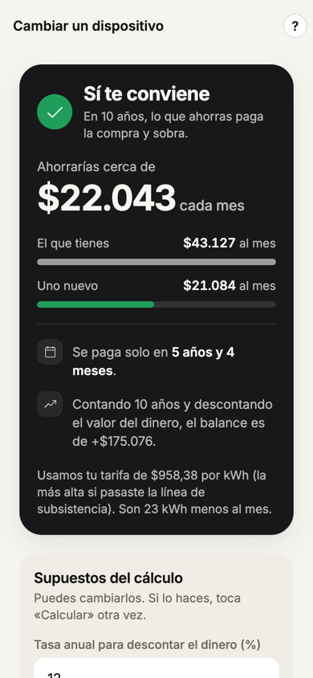</td>
<td>

- **Consejos** (Explorar › Ahorra) te dice qué hacer y cuánto ahorrarías al mes.
- **Cambiar un dispositivo** compara el que tienes con uno nuevo según su **etiqueta RETIQ** (la de eficiencia, de la A a la G):
  1. lo que gasta hoy: si viene de un consejo, lo midió tu enchufe;
  2. lo que gastaría el nuevo, según su etiqueta;
  3. su precio.

  Toca **Calcular** y verás el **veredicto**, el **ahorro al mes** y **en cuánto tiempo se paga solo**.

Supuestos: tasa del 12 % anual y 10 años de vida útil. Los puedes cambiar.

</td>
</tr></table>

#### 🪫 Saldo prepago

<table><tr>
<td width="210">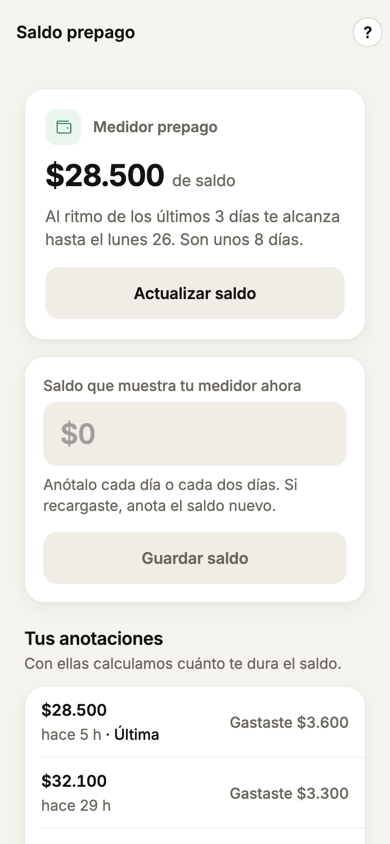</td>
<td>

1. **Explorar › Saldo prepago.**
2. Anota el saldo que muestra tu medidor, **cada día o cada dos días**. Si recargas, anota el saldo nuevo.
3. La app calcula, con lo que gastaste los últimos 3 días, **hasta qué día te alcanza**.

</td>
</tr></table>

#### 🧭 Dónde está cada cosa

<table><tr>
<td width="210">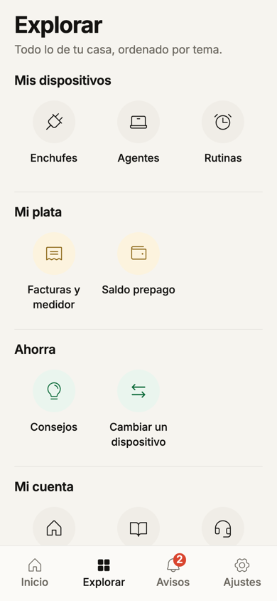</td>
<td>

| Pestaña | Qué hay |
| --- | --- |
| 🏠 **Inicio** | Semáforo, gasto de hoy, ahora mismo, dispositivos |
| 🔲 **Explorar** | **Mis dispositivos:** Enchufes · Agentes · Rutinas<br/>**Mi plata:** Facturas y medidor · Saldo prepago<br/>**Ahorra:** Consejos · Cambiar un dispositivo<br/>**Mi cuenta:** Mis casas · Instrucciones · Ayuda al cliente |
| 🔔 **Avisos** | Sin leer, anteriores y sensibilidad |
| ⚙️ **Ajustes** | Perfil, casas, ayuda, tus datos, cerrar sesión, eliminar tu cuenta |

¿Dudas? Cada sección tiene un botón **?**, y **Explorar › Instrucciones** explica todos los temas. Para hablar con una persona: **Ajustes › Ayuda al cliente**.

</td>
</tr></table>

---

## 4. Preguntas frecuentes

<details>
<summary><b>¿Por qué no aparece el consumo de un enchufe?</b></summary>

Revisa en este orden:
1. **Explorar › Enchufes:** ¿dice «Conectado»? Si dice **«Sin agente asignado»**, ábrelo y elige qué agente lo lee.
2. **El computador** del agente está prendido, en la **misma WiFi** que el enchufe, y el ⚡ dice «Conectado».
3. **El enchufe** responde en Smart Life. Si no, desconéctalo de la pared 10 segundos y vuelve a conectarlo.
</details>

<details>
<summary><b>¿Por qué el semáforo sale apagado?</b></summary>

Le falta un dato para comparar: tus **facturas** (los 6 meses) o dos **lecturas del medidor** en días distintos. La tarjeta trae el botón para anotarlo.
</details>

<details>
<summary><b>¿Los enchufes miden toda la casa?</b></summary>

No: miden solo lo que está conectado a ellos. Para comparar el mes de **toda la casa**, la app usa las lecturas del medidor de EPM que anotas. Sin ellas, lo dice: «Solo cuenta lo que miden tus enchufes».
</details>

<details>
<summary><b>¿El costo es igual al de la factura?</b></summary>

Se calcula con la **tarifa oficial de EPM** de tu estrato y del mes, en sus **dos bloques**: hasta y por encima de los 130 kWh de subsistencia. Una prueba automática reproduce **al centavo** una factura real de EPM (250 kWh → $202.141,58).
</details>

<details>
<summary><b>¿Qué pasa si se va el internet?</b></summary>

El agente sigue leyendo y guarda las lecturas en el computador. Cuando vuelve el internet, las envía todas, sin duplicados. No se pierde consumo.
</details>

<details>
<summary><b>¿Me llegan los avisos con la app cerrada?</b></summary>

Todavía no: hoy los avisos se ven dentro de la app. El aviso con la app cerrada llega en la Fase 7: en Android requiere una compilación propia; en iPhone, la cuenta de pago de Apple.
</details>

<details>
<summary><b>¿Cómo borro mis datos?</b></summary>

**Ajustes › Eliminar mi cuenta.** Se borra tu cuenta y, con ella, las casas en las que eres la única persona, con todo lo suyo (enchufes, lecturas, facturas, avisos y rutinas). En una casa compartida solo sales tú. Es el derecho de supresión de la Ley 1581 de 2012.
</details>

---

## 5. Instalar y correr el proyecto

> [!NOTE]
> La guía con **todos** los comandos, en orden y con las soluciones a los problemas típicos, está en **[docs/comandos.md](docs/comandos.md)**.

### Requisitos

| Herramienta | Versión | Para qué |
| --- | --- | --- |
| Node.js | 20 o más | La app |
| Python | 3.12 | El servidor y el agente |
| Docker | Cualquiera reciente | La base de datos local (solo para desarrollar) |
| Expo Go | La de la tienda | Abrir la app en el teléfono sin compilar |
| Xcode | Opcional | Instalar en iPhone de forma permanente |

### Arranque en 3 pasos

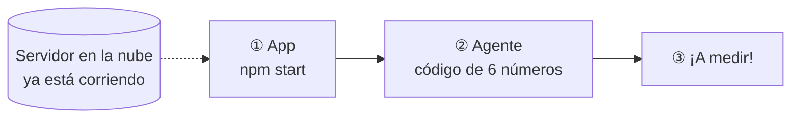

**① La app** (contra el servidor que ya está en la nube)
```bash
cd apps/mobile
cp ../../.env.example .env          # pon EXPO_PUBLIC_API_URL=https://gestion-consumo-api.onrender.com
npm install
npm start                           # escanea el QR con Expo Go (Android) o con la cámara (iPhone)
```

**② El agente** (en el computador de la casa)
```bash
# Opción para usuarios: el programa de Mac
cd services/agent && ./instalador/construir_mac.sh       # crea dist/Apague-y-vamonos-Mac.zip

# Opción para desarrolladores: desde la terminal
cd services/agent
python3.12 -m venv .venv && .venv/bin/pip install -e .
.venv/bin/python -m agent --vincular 123456              # el código que muestra la app
```

**③ El servidor local** (opcional, si no usas el de la nube)
```bash
docker compose -f infra/local/docker-compose.yml up -d   # PostgreSQL
cd services/api
python3.12 -m venv .venv && .venv/bin/pip install -e ".[dev]"
.venv/bin/alembic upgrade head
.venv/bin/uvicorn app.main:app --reload                  # documentación viva en http://localhost:8000/docs
```

> [!IMPORTANT]
> El servidor gratuito de Render **se duerme tras 15 minutos sin uso**: el primer ingreso puede tardar hasta un minuto. Antes de una demo, despiértalo abriendo https://gestion-consumo-api.onrender.com/salud dos minutos antes.

### Variables de entorno

| Dónde | Variable | Qué es |
| --- | --- | --- |
| Servidor | `DATABASE_URL` | Conexión a PostgreSQL |
| Servidor | `JWT_SECRET` | Firma de las sesiones (32 caracteres o más) |
| Servidor | `CLAVE_MAESTRA` | Cifra las claves locales de los enchufes |
| Servidor | `TUYA_ACCESS_ID`, `TUYA_ACCESS_SECRET`, `TUYA_REGION=us` | Nube de Tuya (respaldo de órdenes) |
| Servidor | `GOOGLE_CLIENT_ID`, `GOOGLE_CLIENT_SECRET` | «Continuar con Google» |
| Servidor | `BREVO_API_KEY`, `CORREO_REMITENTE_EMAIL` | Envío de los códigos por correo |
| Servidor | `EXPO_ACCESS_TOKEN` | Notificaciones push |
| Servidor | `COMPARTIR_ENCHUFES` | Modo de pruebas: ⚠️ `false` antes de abrir la app a otras personas |
| App | `EXPO_PUBLIC_API_URL` | Dirección del servidor |
| Agente | `AGENT_API_URL`, `AGENT_TOKEN`, `AGENT_POLL_SECONDS=5` | Solo si no usas la vinculación con código |

La plantilla está en [.env.example](.env.example). **Nunca** subas un `.env` al repositorio.

---

## 6. Cómo está hecho

### Tecnología

| Pieza | Tecnología |
| --- | --- |
| 📱 App | Expo SDK 57 · React Native 0.86 · TypeScript estricto · Expo Router · TanStack Query · Zustand · expo-secure-store · Inter · Phosphor Icons |
| ⚙️ Servidor | Python 3.12 · FastAPI · SQLAlchemy 2 · Alembic · APScheduler · Argon2 · JWT · Fernet |
| 🗄️ Datos | PostgreSQL (Neon en la nube, Docker en local) · 19 tablas · 12 migraciones |
| 💻 Agente | Python 3.12 · TinyTuya · SQLite · websockets · PyInstaller (programa de Mac) |
| ☁️ Servicios | Render (servidor) · Neon (base) · Brevo (correo) · Expo Push · Google OAuth · Tuya Cloud (respaldo) |

### Carpetas

```
.
├── apps/mobile/            📱 La app (33 pantallas)
│   ├── app/                   Una pantalla por archivo: (tabs) Inicio · Explorar · Avisos · Ajustes, y el resto
│   └── src/                   api · realtime (en vivo) · features · components · theme (diseño) · lib
├── services/api/           ⚙️ El servidor
│   ├── app/modules/           auth · hogares · agentes · dispositivos · ingesta · consumo · alertas · prepago · rutinas · retiq · tarifas
│   ├── app/jobs/              Tareas que corren solas (avisos, rutinas, consolidación, limpieza)
│   ├── migrations/            Historial de la base (Alembic)
│   └── tests/                 376+ pruebas
├── services/agent/         💻 El agente de la casa
│   ├── agent/                 collector (lee) · buffer (cola sin internet) · commands (órdenes) · app de Mac
│   └── instalador/            Construye el programa de Mac
├── docs/                   📚 Guías, decisiones (ADR), historias de usuario, capturas
├── infra/local/            🐳 PostgreSQL con Docker
└── render.yaml             ☁️ Despliegue en Render
```

Cada módulo del servidor tiene los mismos cuatro archivos: `router.py` (las rutas), `schemas.py` (la forma de los datos), `models.py` (las tablas) y `service.py` (la lógica).

### Lo que corre solo en el servidor

| Cada | Tarea |
| --- | --- |
| 20 s | Revisar los avisos |
| 1 min | Ejecutar las rutinas que vencen |
| 1 hora | Resumir el consumo por hora y revisar el consumo anómalo |
| 1 día | Borrar las lecturas de más de 30 días (el resumen por hora se guarda siempre) |

### Cómo se calcula la plata

```
Energía (kWh) = Σ potencia (W) × tiempo (s) ÷ 3.600.000      → un hueco de más de 60 s no se cuenta
Costo ($)     = kWh hasta 130 × tarifa de subsistencia  +  kWh por encima × tarifa plena
```
Estrato 3, septiembre de 2026, medidor de EPM: **$814,63** por kWh hasta 130 kWh y **$958,38** por encima ([ADR 0002](docs/decisiones/0002-tarifa-epm-septiembre-2026.md)). **La app no calcula plata:** todo viene del servidor, así el número es el mismo en Android, en iPhone y en la factura.

---

## 7. Pruebas y calidad

### Pruebas automáticas

| Parte | Comando | Pruebas | Revisan, por ejemplo |
| --- | --- | :-: | --- |
| 📱 App | `cd apps/mobile && npx tsc --noEmit && npx jest` | 246 | Pantallas, sesión, tiempo real, formato de pesos y **accesibilidad** (texto ≥ 15 px, toques ≥ 44 px) |
| ⚙️ Servidor | `cd services/api && .venv/bin/pytest` | 377 | Factura real al centavo, cada aviso, rutinas, prepago, seguridad entre casas, cifrado, simulador |
| 💻 Agente | `cd services/agent && .venv/bin/pytest` | 79 | Cola sin internet sin duplicados, reintentos, órdenes, vinculación |
| 🎨 Diseño | `cd apps/mobile && npm run vitrina:servidor` y luego `npm run vitrina -- <carpeta>` | 36 capturas | Todas las pantallas y sus estados, sin teléfono |

### Criterios de calidad medidos

| Criterio | Meta | Resultado | Estado |
| --- | --- | --- | :-: |
| Del enchufe a la pantalla | ≤ 5 s | **0,44 s** como máximo | ✅ |
| Aviso tras cruzar el límite | ≤ 60 s | **15 s** | ✅ |
| Apagar desde la app | ≤ 10 s | **0,96 s** (agente simulado) | 🟡 falta con el enchufe real |
| Costo | Igual a kWh × tarifa | **Al centavo** con una factura real | ✅ |
| Sin huecos ni duplicados sin internet | Sin huecos > 1 min | **0 duplicados**, máx. 5 s entre lecturas | ✅ |
| Precisión de potencia | Error ≤ 10 % | **+9,1 %** (48 W contra 44 W); hay calibración | 🟡 falta el bombillo |
| Accesibilidad | Texto ≥ 15 px, toques ≥ 44 px | Prueba automática | ✅ |
| Ensayo de demo | 30 min sin fallas | — | ⏳ |

El detalle y la evidencia de cada uno están en [docs/verificacion-calidad.md](docs/verificacion-calidad.md).

---

## 8. Seguridad y datos

| Qué | Cómo |
| --- | --- |
| 🔑 Contraseñas | Nunca se guardan tal cual: resumen irreversible con **Argon2** |
| 🎫 Sesión | Pase temporal (**JWT**) de 15 min que se renueva solo hasta 30 días; guardado en el almacén cifrado del teléfono |
| 🏠 Casas | Cada petición verifica que perteneces a esa casa (hay pruebas que intentan lo contrario y deben fallar) |
| 🔌 Enchufes | La clave local de cada enchufe se guarda **cifrada** y solo la recibe el agente asignado; nunca llega a la app |
| 🔒 Tráfico | Todo por **HTTPS** y **WSS**; límite de frecuencia en prender y apagar |
| ⚖️ Ley 1581 de 2012 | Consentimiento al registrarse, política de datos en la app y **Eliminar mi cuenta** |
| 🤫 Secretos | Ninguno en el repositorio: `.env*`, `devices.json` y `tinytuya.json` están en `.gitignore` |

> [!WARNING]
> **Antes de abrir la app a otras personas:**
> 1. Poner `COMPARTIR_ENCHUFES=false` en Render.
> 2. Rotar los secretos que quedaron expuestos en conversaciones: Neon, Tuya y el token del agente.
> 3. Hacer revisar la política de datos por un abogado (hoy es un borrador).

---

## 9. Estado y pendientes

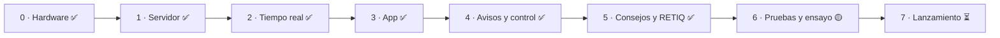

| Pendiente | Necesita |
| --- | --- |
| Precisión de potencia con un bombillo incandescente | El enchufe |
| Apagar con el enchufe real y el programa de Mac | El enchufe |
| Ensayo de 30 min en Android e iPhone, y video de respaldo | Los teléfonos |
| Activar Brevo y Google en Render | Las cuentas del equipo |
| Número de WhatsApp de soporte | El equipo |
| Avisos con la app cerrada, tiendas, agente para Windows | Fase 7 |

Fuera de alcance: **HU-06 excedentes solares** (no hay datos de inversor).

---

## 10. Documentación

| Documento | Qué tiene |
| --- | --- |
| 📘 [Guía del producto](docs/guia-del-producto.md) | Todo explicado sin conocimientos previos: arquitectura, código, pruebas, negocio y cómo presentarlo |
| ⌨️ [Comandos](docs/comandos.md) | Todos los comandos, en orden, y los problemas típicos |
| 🧪 [Guía de prueba](docs/guia-de-prueba.md) | Qué probar en los teléfonos y qué debe pasar |
| ✅ [Verificación de calidad](docs/verificacion-calidad.md) | Cada criterio con su evidencia |
| 🎨 [Manual de diseño](docs/diseno.md) | Voz y tono, color, tipografía, componentes |
| 🧭 [Decisiones (ADR)](docs/decisiones/) | 12 decisiones con su porqué |
| 📋 [Historias de usuario](docs/historias-usuario/) | HU-01 a HU-08 con criterios de aceptación |
| Por carpeta | [App](apps/mobile/README.md) · [Servidor](services/api/README.md) · [Agente](services/agent/README.md) |

<div align="center">

---

Hecho en Medellín para que apagar a tiempo se note en la factura. ⚡

</div>
